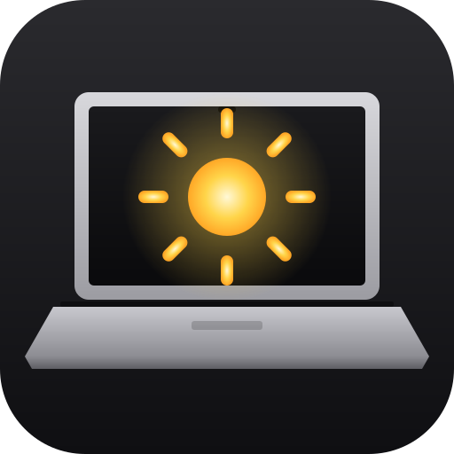
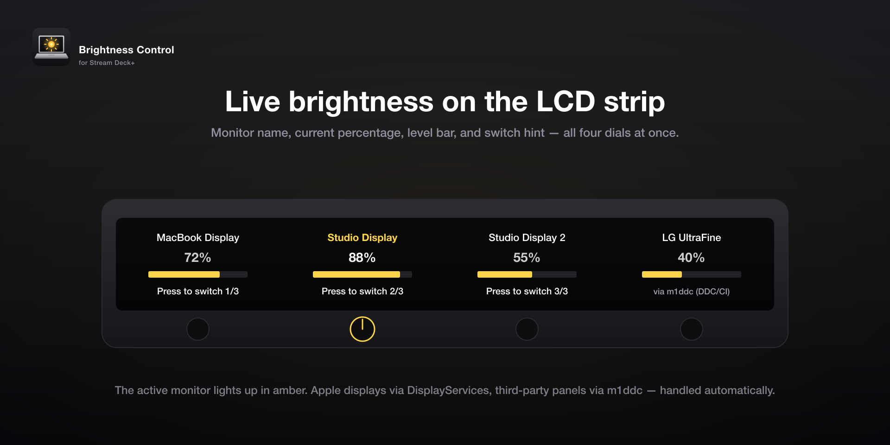
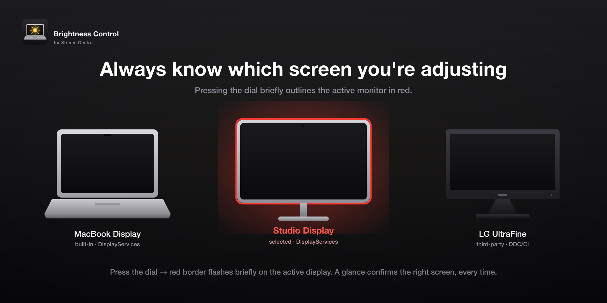
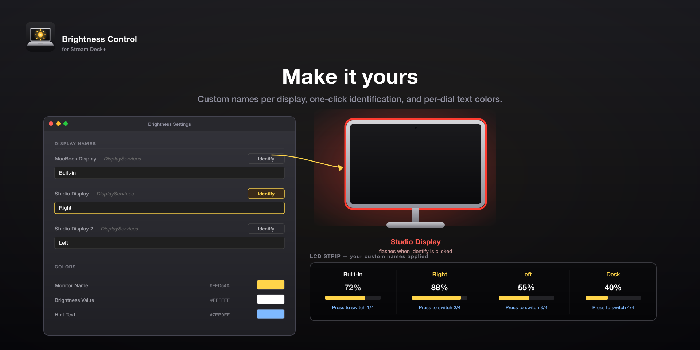

  

<h1 align="center">Brightness Control</h1>

<em>Stream Deck plugin for Mac display brightness</em>

  
  
  
  

Adjust the brightness of every Mac-connected display directly from your Stream Deck+ dials, or jump to a fixed level with one press of a key. Built on Apple's native DisplayServices — works reliably with Apple Studio Display, Pro Display XDR, and the built-in MacBook display where most third-party tools fail.

> 🚀 **Quickstart:** Install via [**Elgato Marketplace**](https://marketplace.elgato.com/product/brightness-control-54d6a22a-2fe4-47a3-a0a1-9204efc5232b) (one click inside the Stream Deck app), or [download the bundle](https://github.com/Corrugator/streamdeck-mac-brightnesser/releases/latest) here for manual install.

---

## What it does

### Live brightness on every dial

Each dial either stays on one monitor you pick, or cycles through all of them — a new dial starts in cycle mode. Rotate to adjust brightness in 2 % steps. In cycle mode, press the dial to move on to the next monitor. The LCD shows monitor name, exact percentage, a live bar, and a hint such as `Press to switch 2/3`. Every dial is independent, so a row of dials can control a row of monitors.

### Always know which screen you're tuning

When a dial in cycle mode switches monitors, the newly selected one is briefly outlined in red — a quick glance confirms you're tuning the right screen, especially handy with two identical displays side by side.

### Fixed levels on a key

The **Brightness Preset** action puts a fixed brightness on a regular key. Pick one monitor or **All displays**, set the level, and a single press applies it. Handy as a pair: one key for night, one for day. Works on any Stream Deck with keys.

### Make it yours

Pick custom text colors per dial. Rename each display to whatever makes sense to you ("Right", "Left", "Desk") — names persist across reboots and re-plugs. While editing, click **Identify** to flash the matching physical monitor in red so you always know which one you're naming.

---

## Features at a glance

- **Rotate to adjust** — 2 % brightness step per dial tick
- **One dial per monitor, or cycle** — pin a dial to a specific display, or let it cycle through all of them
- **Press behavior** — in cycle mode, press moves to the next monitor; a pinned dial does nothing on press by default, or opens System Settings → Displays if you turn that on
- **Brightness Preset keys** — a fixed level for one monitor or all monitors, with one press
- **Active-display indicator** — red border briefly flashes on the newly selected screen
- **Rename displays** — custom names that persist across reboots and re-plugs
- **Identify button** — flashes a monitor in red so you can match name to hardware
- **Custom text colors** — monitor name, value and hint line, per dial
- **Auto-refresh** every 10 s — keeps in sync with external brightness changes (every 2 s while a monitor is missing)
- **Recovers on its own** after sleep/wake and when the Stream Deck reconnects, e.g. after a dock swap
- **Privacy-respecting** — diagnostic logging is opt-in (off by default)
- **Universal Binary** — single helper covers Apple Silicon and Intel

---

## Supported displays

| Display | How it's driven |
|---|---|
| MacBook built-in | Apple DisplayServices |
| Apple Studio Display | Apple DisplayServices |
| Apple Pro Display XDR | Apple DisplayServices |
| Apple Thunderbolt Display | Apple DisplayServices |
| Other DDC/CI monitors | optional [`m1ddc`](https://github.com/waydabber/m1ddc) fallback |

The DisplayServices path uses the same private framework macOS itself uses for the System Settings brightness slider — that's why this plugin handles Studio Display and Pro Display XDR cleanly.

## Requirements

- macOS 12 (Monterey) or newer
- Stream Deck App 6.9 or newer
- Stream Deck+ for the **Brightness** dial action; **Brightness Preset** works on any Stream Deck with keys
- *Optional:* `brew install m1ddc` for non-Apple DDC/CI displays. Use m1ddc 1.3 or newer (`brew upgrade m1ddc`): older versions crash while a Sidecar or AirPlay display is connected, and on some monitors fail to read the current brightness.

## Installation

**Recommended — Elgato Marketplace:**
[Brightness Control on the Marketplace](https://marketplace.elgato.com/product/brightness-control-54d6a22a-2fe4-47a3-a0a1-9204efc5232b) — open the link in the Stream Deck app and click install.

**Manual — from GitHub:**

1. Download `com.corrugator.brightness.streamDeckPlugin` from the [latest release](https://github.com/Corrugator/streamdeck-mac-brightnesser/releases/latest).
2. Double-click the file. The Stream Deck app installs it automatically.
3. Drag the **Brightness** action onto a Stream Deck+ dial, or **Brightness Preset** onto a key, and pick a monitor in its settings.

Release candidates for upcoming versions are on the [releases page](https://github.com/Corrugator/streamdeck-mac-brightnesser/releases), marked as pre-release.

## Privacy

- 100 % local — no telemetry, no analytics, no network calls outside the local Stream Deck WebSocket.
- Diagnostic logging is **opt-in** — off by default. Enable it in a dial's settings under **Diagnostics** when troubleshooting. Logs stay in the plugin's own folder, `~/Library/Application Support/com.elgato.StreamDeck/Plugins/com.corrugator.brightness.sdPlugin/logs/`, and never leave your machine.

## Known limitations

- macOS only — DisplayServices is an Apple-private API.
- DDC/CI monitors need `m1ddc`, and for them only brightness works: **Identify** and the red outline need a display ID the plugin doesn't map for DDC monitors yet ([#7](https://github.com/Corrugator/streamdeck-mac-brightnesser/issues/7)).
- Some inexpensive USB-C monitors expose neither DisplayServices nor DDC/CI — those will not appear in the display list.
- Apple may change DisplayServices in a future macOS release without notice; this plugin will need a patch if/when that happens.

## License

See [LICENSE](LICENSE).
